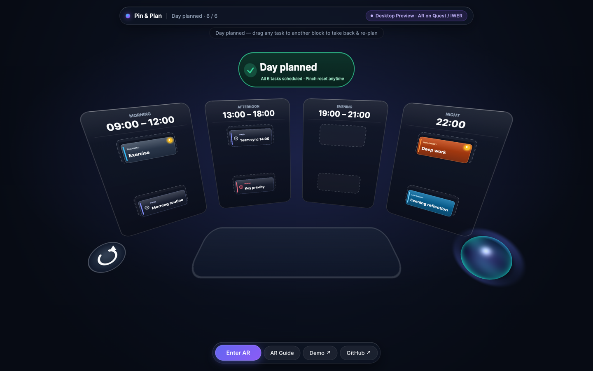

# Pin & Plan 📌

> **Seated, hands-only WebXR morning planner in passthrough AR for Meta Quest 3 & Quest 3S — with interactive Desktop Preview.**  
> Built for the **Meta VR Start Developer Competition 2026** · *Productivity Track (New Experience Division)*

<p align="center">
  
</p>

---

## 🔗 Quick Links

- 🚀 **Live WebXR App (with Desktop Preview):** [https://pin-and-plan.vercel.app](https://pin-and-plan.vercel.app)
- 🏆 **Devpost Project:** [https://devpost.com/software/pin-plan](https://devpost.com/software/pin-plan)
- 📺 **Demonstration Video:** [Watch on YouTube](https://youtu.be/hPLJEprhNcc) · [Local MP4](pin-and-plan-media/pin-and-plan-demo.mp4)

---

## 💡 Overview & The Interaction Loop

Traditional productivity tools break down in spatial computing when they replicate 2D floating windows or controller menus. **Pin & Plan** reimagines morning scheduling as a physical, tactile ritual at your desk in passthrough AR.

Instead of an opaque AI black box that removes your autonomy, Pin & Plan uses a collaborative **"Pin → Hand Over → Take Back"** agentic loop:

```
[ 1. Pin ]                 [ 2. Hand Over ]                  [ 3. Take Back ]
Grab & drop 1–2       →    Activate the glowing         →    Move any placed task.
priority tasks onto        Fresnel Agent Orb. It             It locks as your pin,
morning time blocks.       places remaining tasks            and the agent re-plans
                           step-by-step with 3D              only affected tasks.
                           XAI reason chips.
```

1. **Pin (User Agency):** Grab and drop your non-negotiable tasks (*Exercise*, *Deep work*, etc.) onto curved frosted-glass time blocks (`09:00 – 12:00`, `13:00 – 18:00`, `19:00 – 21:00`, `22:00`). Hovering illuminates valid blocks in indigo/cyan (or warns crimson if a block already holds 2 pins), and pinned tasks lock with a luminous gold emblem.
2. **Hand Over (Agent Collaboration):** Activate the glowing GLSL Fresnel **Agent Orb** on your right. The deterministic scheduler evaluates fixed times, urgency, energy alignment, and block capacities—flying unassigned tasks along smooth 3D arcs (0.5 s apart) while displaying pill-shaped 3D reason chips (`"Fixed time"`, `"Urgent → first"`, `"09:00–12:00 full → next"`).
3. **Take Back (Fluid Control):** Disagree with the agent? Move any agent-placed task to another block. It promotes immediately to a user pin and the agent minimally re-plans only the affected tasks.

---

## 📸 Visual Walkthrough & Gallery

<table width="100%">
  <tr>
    <td width="50%" align="center">
      
      <br /><b>01. Spatial Workspace &amp; Enter AR</b><br /><sub>Curved glass panels, tactile energy cards, Fresnel orb, and compact HUD</sub>
    </td>
    <td width="50%" align="center">
      
      <br /><b>02. Live Drop-Target Affordance</b><br /><sub>Hovering illuminates valid target glass rims and cyan slot wells</sub>
    </td>
  </tr>
  <tr>
    <td width="50%" align="center">
      
      <br /><b>03. User Pin &amp; Inviting Agent Orb</b><br /><sub>Gold pin emblem locks your decision; orb halo pulses ready</sub>
    </td>
    <td width="50%" align="center">
      
      <br /><b>04. Staged Placement &amp; 3D XAI Chips</b><br /><sub>Parabolic flight arcs paired with capsule reason chips explaining each rule</sub>
    </td>
  </tr>
  <tr>
    <td width="50%" align="center">
      
      <br /><b>05. "Day Planned" Completion</b><br /><sub>Celebratory emerald glass banner and settled emerald-violet orb</sub>
    </td>
    <td width="50%" align="center">
      
      <br /><b>06. Take Back &amp; Minimal Re-Planning</b><br /><sub>Drag any scheduled task to override; previous pins always hold</sub>
    </td>
  </tr>
</table>

---

## ⚡ Technical Highlights

- **100% Hands-Only in WebXR + Interactive Desktop Preview:** Built for Meta Quest 3/3S natural hand tracking via `@iwsdk/core` 1.1 (`immersive-ar`, `useHandPinchForGrab`, zero controllers). When opened on a standard desktop or mobile browser without a headset, a non-immersive pointer preview lets anyone drag tokens, trigger the Agent Orb, and test the full loop immediately—alongside a native `popover` AR setup guide.
- **Zero Downloaded External Assets:** Every mesh, rounded frosted-glass panel (`512×728` aspect-matched `CanvasTexture` with `anisotropy = 4`), GLSL Fresnel Aurora Agent Orb (`ShaderMaterial`), and harmonic WebAudio sound cue is generated procedurally in code. Cold load under 1 second, ~26 draw calls, zero shadows, zero post-processing.
- **Deterministic Pure Planner Engine:** Decoupled TypeScript scheduling & diffing core (`src/planner/`) with zero DOM/Three.js dependencies—verified by **40 automated Vitest tests** (34 scheduling/determinism cases + 6 spatial motion curve tests).
- **Seated Ergonomic Geometry:** Anchored to the user's head pose at session start within a 60 cm reach envelope (`±60°` arc, `≥ 12 cm` spacing between all grabbables to eliminate hand grip-space neighbor grabs).

---

## 📂 Repository Structure

```
.
├── README.md                   # Project overview & visual walkthrough
├── index.html                  # WebXR entry point
├── package.json                # Dependencies & scripts
├── tsconfig.json               # TypeScript configuration
├── vite.config.ts              # Vite build configuration
├── vitest.config.ts            # Unit test configuration
├── iwsdk.config.json           # Meta Immersive Web SDK configuration
├── pin-and-plan-media/         # High-res v2.0 screenshots & demo MP4
└── src/
    ├── planner/                # Pure deterministic scheduling engine (0 DOM/3D imports)
    │   ├── plan.ts             # 4-pass deterministic scheduler
    │   ├── diff.ts             # Minimal delta calculator (moves vs. slides)
    │   ├── content.ts          # Morning blocks & task metadata
    │   ├── types.ts            # Core data models
    │   └── plan.test.ts        # 34 Vitest scheduling & determinism tests
    ├── design/                 # Unified Spatial + Web Design System
    │   ├── tokens.ts           # Palette, typography, canvas budgets, motion tokens
    │   ├── canvas.ts           # High-DPI rounded glass & vector UI canvas renderer
    │   ├── shaders.ts          # Procedural GLSL Fresnel Aurora Orb & halo shaders
    │   ├── motion.ts           # Allocation-free arcs, spring settles, shakes
    │   └── motion.test.ts      # 6 Vitest animation curve tests
    ├── scene/                  # WebXR 3D workspace & interaction systems
    │   ├── layout.ts           # 60 cm seated arc coordinates & spacing
    │   ├── rig.ts              # Glass panels, beveled cards, Fresnel orb, tray rail
    │   ├── planner-system.ts   # ECS state machine, staged queue, hover affordances
    │   ├── desktop-pointer.ts  # Non-XR pointer preview adapter (inert in WebXR)
    │   └── commands.ts         # Diff-driven scene command types
    ├── feedback/               # Multimodal XAI & audio feedback
    │   ├── chips.ts            # Pooled animated 3D reason pills
    │   ├── end-card.ts         # Animated "Day planned" glass banner
    │   ├── hint.ts             # Onboarding ghost arc + 4-state orb animator
    │   └── sounds.ts           # Procedural harmonic WebAudio foley
    ├── ui/
    │   └── hud.ts              # Compact header, dock & native top-layer AR popover
    ├── styles/
    │   └── hud.css             # Midnight Spatial Studio tokens, linear() spring, @starting-style
    └── index.ts                # Application bootstrap
```

---

## 🛠️ Local Development & Testing

### Prerequisites
- Node.js 20+
- `pnpm` 9+ (recommended) or `npm`

### Setup & Run
```bash
# Install dependencies
pnpm install

# Run all 40 unit tests (planner + motion curves)
pnpm test

# Start the local development server
pnpm dev

# Type-check & build for production
pnpm exec tsc --noEmit && pnpm build
```

### Trying Pin & Plan
- **Desktop / Mobile Browser (Instant Preview):** Visit [https://pin-and-plan.vercel.app](https://pin-and-plan.vercel.app) and drag any task token onto a block, click the glowing violet orb, move tasks to take back control, or click the reset button on the left.
- **Meta Quest 3 / Quest 3S (Hands-Only Passthrough AR):** Open [https://pin-and-plan.vercel.app](https://pin-and-plan.vercel.app) in **Meta Quest Browser** and pinch **Enter AR**.
- **Desktop Chrome Emulator (IWER):** Install the **Immersive Web Emulator (IWER)** extension → open DevTools **WebXR** tab → select **Meta Quest 3** with **Hand Tracking** → click **Enter AR**.

---

## 📜 License

MIT License
